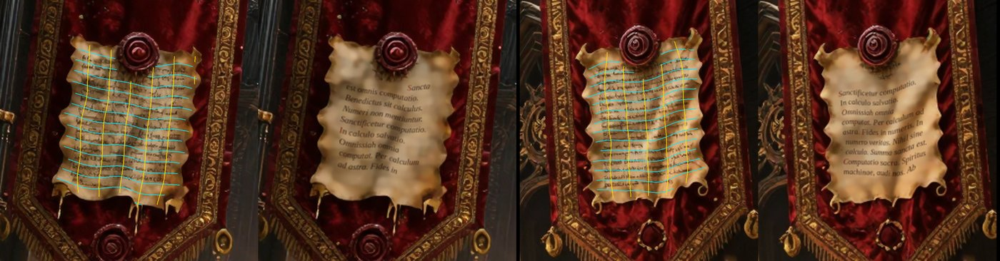
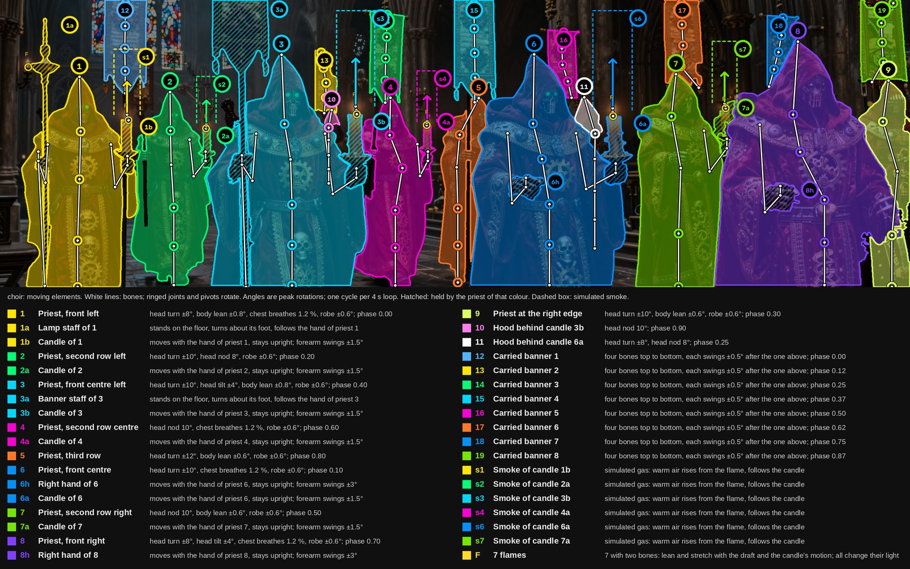
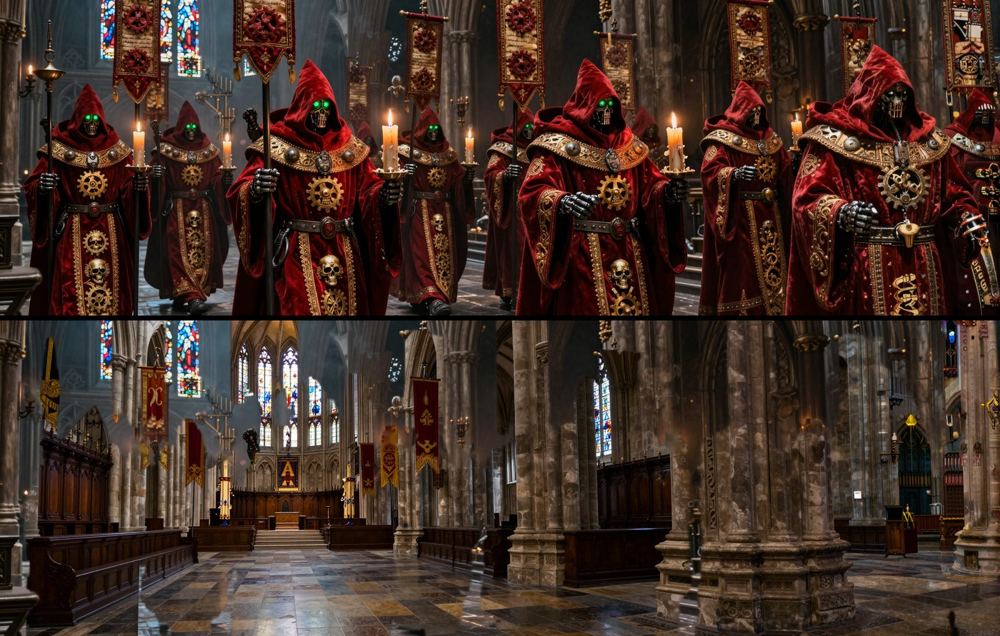
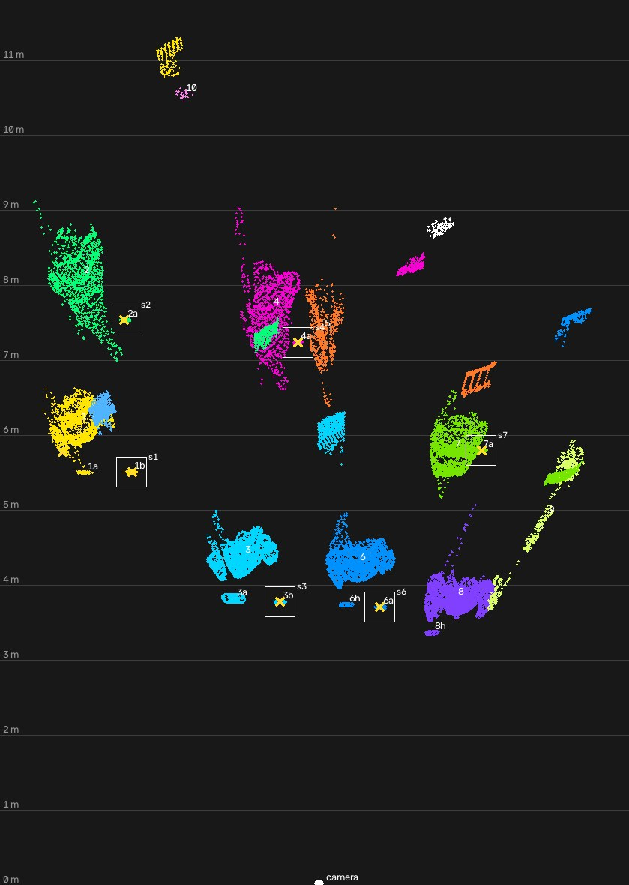
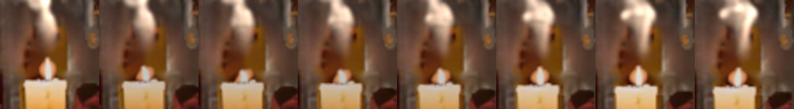
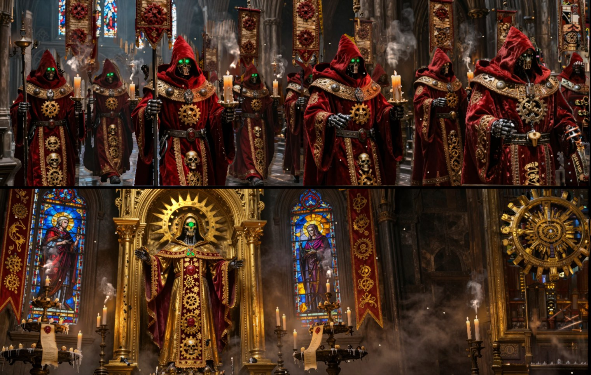

# w40k-mechanicum - Animation pipeline v1

Status: DRAFT for internal review, 2026-10-10.

## Contents

- [1. Overview](#1.-Overview)
  - [1.1 Pipeline diagram](#1.1-Pipeline-diagram)
  - [1.2 Outputs](#1.2-Outputs)
- [2. Image generation](#2.-Image-generation)
  - [2.1 Z-Image-Turbo](#2.1-Z-Image-Turbo)
  - [2.2 Textures](#2.2-Textures)
  - [2.3 Scene plates](#2.3-Scene-plates)
  - [2.4 Latin](#2.4-Latin)
  - [2.5 Text on surfaces](#2.5-Text-on-surfaces)
- [3. Depth from the image](#3.-Depth-from-the-image)
- [4. Cathedral scene](#4.-Cathedral-scene)
- [5. Plate scene animation](#5.-Plate-scene-animation)
  - [5.1 Motion map](#5.1-Motion-map)
  - [5.2 Segmentation](#5.2-Segmentation)
  - [5.3 Clean plate](#5.3-Clean-plate)
  - [5.4 Actors](#5.4-Actors)
  - [5.5 Placement rules](#5.5-Placement-rules)
  - [5.6 Air, flames and candle light](#5.6-Air,-flames-and-candle-light)
  - [5.7 Smoke](#5.7-Smoke)
  - [5.8 Wheels, cloth and streams](#5.8-Wheels,-cloth-and-streams)
  - [5.9 Plate effects and camera](#5.9-Plate-effects-and-camera)
  - [5.10 Checks before a render](#5.10-Checks-before-a-render)
  - [5.11 Crowd](#5.11-Crowd)
  - [5.12 Outdoor scene with cloth and crowd](#5.12-Outdoor-scene-with-cloth-and-crowd)
- [6. Loop and timing](#6.-Loop-and-timing)
- [7. Rendering and assembly](#7.-Rendering-and-assembly)
- [8. Development workflow](#8.-Development-workflow)
- [9. Commands](#9.-Commands)

## 1. Overview

This document describes how the looping banner animations are made, from image generation to the finished GIF. The project has two pipelines that share the same textures, Latin, loop rules and GIF assembly.

- **Cathedral pipeline** - `src/mechanicum.py` builds a full 3D cathedral in Blender from downloaded models, procedural geometry and generated textures, and renders it from one of four camera positions
- **Plate pipeline** - one generated image (a plate) gets depth from MoGe-2. Every element that moves is cut out with SAM 2.1 and becomes its own mesh with bones in front of a plate painted without it. Flames follow a model of the air, smoke is simulated as a gas, and `src/scenes.py` renders the scene with a slow camera drift (section 5)
- **Shared final steps** - both pipelines render numbered PNG frames with Cycles on the GPU, and `src/assemble.py` turns the frames into a 1140 × 360 GIF that loops without a visible jump

### 1.1 Pipeline diagram

The diagram shows each step as the script that performs it, with image generation and depth estimation in purple and Blender in blue.

```mermaid
%%{init: {'themeVariables': {'fontSize': '8px'}, 'themeCSS': '.cluster-label span, .cluster-label text, .edgeLabel span {color:var(--jp-ui-font-color1, var(--vscode-editor-foreground, var(--fgColor-default, #1f2937))); fill:var(--jp-ui-font-color1, var(--vscode-editor-foreground, var(--fgColor-default, #1f2937)))} @media (prefers-color-scheme: dark){.cluster-label span, .cluster-label text, .edgeLabel span {color:var(--jp-ui-font-color1, var(--vscode-editor-foreground, var(--fgColor-default, #e5e7eb))); fill:var(--jp-ui-font-color1, var(--vscode-editor-foreground, var(--fgColor-default, #e5e7eb)))}}'}}%%
flowchart LR
    REF[(references/<br/>target images)]:::data
    subgraph GEN["Image generation"]
        direction TB
        TJ[gentextures.py<br/>texture prompts]:::data --> ZI[Z-Image-Turbo<br/>4 drafts each]:::ai
        PJ[genplates.py<br/>plate prompts]:::data --> ZI
        ZI --> AP[apply: cut-out,<br/>gold mask, stitched Latin]:::ingest
        ZI --> PK[pick: chosen plate]:::ingest
    end
    subgraph CAT["Cathedral pipeline"]
        direction TB
        MOD[(in/models/ via models.py<br/>paintfig.py)]:::data --> MEC[mechanicum.py<br/>nave, altar close-up]:::svc
        PIL[textures.py, emblem.py<br/>parchments, plaques]:::data --> MEC
    end
    subgraph PLT["Plate pipeline"]
        direction TB
        INS[inscribe.py<br/>Latin draped on sheets]:::ai --> MG[img2geometry.py<br/>MoGe-2 depth]:::ai
        MM[motion.py<br/>motion map]:::data --> SG[segment.py<br/>SAM 2.1 masks, flames]:::ai
        MG --> SG
        SG --> CP[cleanplate.py<br/>scene without actors]:::ai
        CP --> BD[backdrop.py<br/>depth mesh, camera]:::svc --> SC[scenes.py<br/>actors, flames, smoke, drift]:::svc
        SG --> AC[actors.py, rig.py<br/>meshes and bones]:::svc --> SC
        AC --> SM[smoke.py<br/>gas simulation]:::svc --> SC
    end
    REF --> TJ
    REF --> PJ
    AP --> MEC
    PK --> INS
    MEC --> FR[(wip/frames-*<br/>PNG + seam check)]:::data
    SC --> FR
    FR --> AS[assemble.py]:::svc --> GIF[out/NN-name.gif]:::act
    classDef data fill:#FFFFFF,stroke:#6B7280,color:#111,font-size:9px
    classDef ingest fill:#0EA5E9,stroke:#0369A1,color:#fff,font-size:9px
    classDef svc fill:#3B82F6,stroke:#2563EB,color:#fff,font-size:9px
    classDef ai fill:#A855F7,stroke:#7E22CE,color:#fff,font-size:9px
    classDef act fill:#10B981,stroke:#047857,color:#fff,font-size:9px
    style GEN fill:none,stroke:#6b7280,stroke-width:3px
    style CAT fill:none,stroke:#6b7280,stroke-width:3px
    style PLT fill:none,stroke:#6b7280,stroke-width:3px
    linkStyle default stroke-width:2.3px
```

*Fig 1 - From reference images to the finished GIF, by script*

### 1.2 Outputs

The finished animations are in `out/`, numbered in the order they were made.

| File | Pipeline | Content | Loop |
|---|---|---|---|
| `01-mechanicum.gif` | cathedral | first nave version | 40 frames, 2 s |
| `02-mechanicum.gif` | cathedral | nave with congregation, priests, banners | 40 frames, 2 s |
| `03-mechanicum-altar.gif` | cathedral | altar close-up with the near servitor | 40 frames, 2 s |
| `04-forge.gif` … `08-hall.gif` | plate | forge, vault, street, saint, hall | 80 frames, 4 s |
| `09-reliquary.gif` … `13-voidshrine.gif` | plate | reliquary, foundry, scriptorium, choir, voidshrine | 80 frames, 4 s |
| `16-muster.avif` | plate with a 3D crowd | rampart walks with a crowd of 149,000 figures, cloth banners, simulated fires and dust (section 5.12) | 360 frames, 12 s, 2432 × 768 |

## 2. Image generation

This section covers how the texture images and the scene plates are generated, and how exact Latin is added to them. One model generates all of them, Z-Image-Turbo, and scripts write every Latin word.

### 2.1 Z-Image-Turbo

Z-Image-Turbo is an open text-to-image model from Tongyi-MAI (Alibaba Tongyi Lab), released in November 2025 under Apache-2.0.

- **Size** - 6 billion parameters in one transformer that reads text tokens and image tokens as one sequence
- **Text encoder** - a Qwen3 language model of about 4 billion parameters
- **Speed** - "Turbo" is a distilled version that needs 8 steps; this project uses 9 steps, guidance scale 0, about 4 s per image on the RTX PRO 6000
- **Runtime** - diffusers `ZImagePipeline` in the venv `.venv-moge`; the weights take 31 GB in the Hugging Face cache
- **Limit** - the model misspells Latin (CALCILUM for CALCULUM, LAUDETTUR, SALVATO), so no generated Latin is used unchecked

### 2.2 Textures

`src/gentextures.py` generates the fabric, metal, glass and surface textures of the cathedral pipeline.

- **Prompts** - `JOBS` holds one prompt and size per texture: antependium, drape, six banners, two hangings, twelve plaques, three reliefs, three stained glass windows and four surface swatches (steel, brass, skin, wool)
- **Style suffixes** - `STYLE` (worn velvet and goldwork), `METAL` (blackened iron) and `GLASS` (leaded glass) describe the wear and ask for a flat frontal view with even light
- **Drafts** - `gen <stem>` writes four seeds per texture to `wip/gen/<stem>_<seed>.png`; a person chooses one draft per texture in `CHOICES` after reading every Latin word
- **Apply** - `apply all` removes the studio background around a textile (flood fill of pale, unsaturated pixels from the border), writes `resources/assets/<stem>.png` and a gold mask `resources/assets/<stem>_gold.png` (hue 22° to 60°, saturation above 0.25, value above 0.30)
- **Use** - the gold mask makes the thread metallic, glossy and raised in the Blender material `embroidered()`

### 2.3 Scene plates

`src/genplates.py` generates the images of the plate pipeline.

- **Size** - 2432 × 768 pixels, the 19:6 shape of the banner, so the plate fills the frame without cropping
- **Prompts** - one scene description per plate in `PLATES`, each followed by the shared `PLATE` suffix: carved and embroidered surfaces, crimson velvet with gold, purity seals, soot and wax, low-key light
- **Drafts** - `gen all 1 2 3 4` writes four drafts per plate; a person chooses one per plate in `PICKS`
- **Pick** - `pick all` copies each chosen draft to `wip/scene3d/<name>.png`; `src/inscribe.py` then writes the Latin on its parchments and book pages (section 2.4)

### 2.4 Latin

Every readable Latin word comes from a script. The prayers are about sanctified calculation (`SANCTA` in `gentextures.py`: SANCTA EST OMNIS COMPUTATIO, NUMERI NON MENTIUNTUR, IN CALCULO SALVATIO and others).

- **Stitched Latin** - `stitch()` fills the plain velvet between motto and fringe of the banners and the drape with gold lettering: satin ridges, a dark couching cord at the edges, a shadow on the pile, tarnish and worn stitches, written into the gold mask as well
- **Parchments and book pages on plates** - `src/inscribe.py` writes the prayer as a flat texture and drapes it on each sheet listed in `PARCHMENTS` and `PAGES` (section 2.5)
- **Purity seals and plaques** - `src/textures.py` draws the parchment strips (`parchment()`, the `LITANY` lines) and the plaques in PIL
- **Motto rule** - where a generated motto must stay, it uses words the model spells: AVE OMNISSIAH, DEUS IN MACHINA, OMNISSIAH VULT, IN CALCULO SALVATIO

### 2.5 Text on surfaces

This section states the rule for every text or decoration that lies on an object in a plate, and how `src/inscribe.py` applies it to parchments and book pages. The text is written as a flat texture and draped on the shape of the object; it is never placed in the image directly.

- **Rule** - the texture follows the shape the picture shows: it bends where the surface bends, shortens where the surface turns away, and waves where the sheet is warped
- **Shape evidence** - two sources, used together: the measured surface (normals and depth) and the outline of the object. A sheet is cut straight, so a wavy edge on the flat chart is warp that the measurement did not resolve
- **Plane text** - allowed only where both sources show a plane: no bend in the surface and straight edges
- **Proof** - `wip/preview/sheets-<name>.png` draws the chart on every sheet beside the result. Grid lines that stay straight on a sheet drawn warped mean the drape failed. Every sheet is checked: one accepted sheet does not prove the others

The two cases that set the rule:

| Sheets | Surface bend | Edge waves | Drape by the surface alone | Drape by surface and edges |
|---|---:|---:|---|---|
| Scriptorium book pages | 16 to 35 degrees | none, the page region is set by hand | accepted: the measured surface carries the bend | the same picture |
| Street banner parchments | 4 to 8 degrees | 2 to 6 px | rejected: the measured surface is a plane, so the text is a straight block | accepted: the lines wave with the sheet |

*Fig 2 - Street parchments: the chart drawn on each sheet (cyan lines are text lines) beside the draped Latin*

`src/inscribe.py` works on one sheet at a time:

1. **Sheet** - SAM 2.1 cuts the whole sheet from five points inside its box in `PARCHMENTS`; the box frames only the written part and would hide the edges. A colour test removes the wax seals. A book page is the quad given in `PAGES`
2. **Surface** - MoGe-2 measures an enlarged crop round the sheet, because on the whole plate a sheet comes out as one flat plane. The depth of every pixel is then solved from the normals by least squares, held loosely to the measured depth
3. **Chart** - a least squares conformal map lays the surface flat: every pixel of the sheet gets a place (u, v) in metres. The chart is turned so that u runs along the lines of the script the model wrote
4. **Edge waves** - `waves()` measures how far each of the four edges of the flat sheet leaves a straight line and carries that wave into the chart, each edge's wave at its own side and a mix between. Notches deeper than 8 % of the sheet's size (a seal over the edge, a torn corner) are bridged. The wave is smoothed until it leans no letter by more than 19 degrees
5. **Texture** - the generated script is removed stroke by stroke, each stroke taking the tone of the sheet beside it, so stains and shading stay. The prayer is written straight on the flat sheet in brown ink with a red initial for every fourth phrase, inside the largest rectangle the sheet holds; seals and marks split its lines
6. **Drape** - every pixel takes the texture's value at its (u, v); the ink darkens the sheet, so the sheet's shading lies on the text as well
7. **Check** - the log line of each sheet gives its bend and its edge waves; the check picture shows the chart. A sheet with room for fewer than 8 words keeps the generated script

## 3. Depth from the image

This section covers how a flat plate becomes a 3D surface that a moving camera can look at.

- **Estimation** - `src/img2geometry.py` runs MoGe-2 (Microsoft, MIT licence, model `Ruicheng/moge-2-vitl-normal`) on GPU and saves `wip/scene3d/<name>.npz`: a metric point map, depth, normals, a validity mask and the camera intrinsics
- **Fill layer** - the script also saves the depth pushed out from every depth break (`bg_depth`, the farthest depth within 25 pixels) and `<name>_bg.png`, the image with the near side of each break inpainted
- **Mesh** - `src/backdrop.py` builds one vertex per 2 pixels and leaves out quads that span a depth break (far corner deeper than 1.25 × near corner); the fill layer sits 1 % behind it and shows only where the front layer has a gap
- **Sky** - pixels MoGe-2 leaves out become a far surface at twice the farthest depth
- **Camera** - a camera with the image's field of view and principal point reproduces the plate exactly from the origin
- **Limit** - camera moves up to about 8 cm show clean parallax; 25 cm and more stretch the image at depth breaks

## 4. Cathedral scene

This section covers the fully 3D pipeline in `src/mechanicum.py`. The detailed look rules are in the project skill `design-w40k`.

- **Shots** - `-- shot=<name>` selects a camera: the full nave (no shot), `offering`, `looming` and `altar`; close-up changes sit under `if SHOT:` in `materials()`, `lights()`, `atmosphere()`, `render_setup()` and `figures()`
- **Models** - `src/models.py` loads the downloaded models in `in/models/originals/` (each with `SOURCE.txt`; licences in `README.md`), joins, turns and scales them
- **Figures painted by part** - `src/paintfig.py` gives each face of a sculpt a class (skin, cloth, machine, leather, brass, rubber) from rules on face position and normal; `painted()` assigns one material per class
- **Materials** - distressed gold, absorbent velvet, embroidered textiles from section 2.2, box-projected relief panels, photographic surface swatches with corrosion, and `weather()` for soot, grime and dust on every close-up material
- **Iconography** - the Cog Mechanicum medallion painted in its seven parts, purity seals, candle clusters with wax drips, coolant tubes, curtains and hangings
- **Light** - candles, the relic beam and spots that shine through a leaded window pattern made in the light's own node tree (`window_light()`), so no window geometry appears in frame
- **Grade** - close-ups use AgX with the Punchy look at exposure -0.15 and haze density 0.005; the nave keeps its own grade

## 5. Plate scene animation

This section covers how a still plate becomes a scene whose elements move: which elements move, how they are cut out, what stands behind them, how they are rigged, where they are placed, and how flames, light, smoke and the remaining effects are made. `src/build-scene.sh` runs the steps in the order of the table; `src/scenes.py` renders the result.

| Step | Script | Result | Check |
|---|---|---|---|
| Motion map | `src/motion.py` (`MAPS`) | every moving element with its kind, box, points and motion | `wip/preview/motion-<name>.png` |
| Masks | `src/segment.py cut` | one mask per element, `<name>_sam.npz` | the masks drawn on the motion map |
| Painted smoke out | `src/cleanplate.py <name> desmoke` | the plate without painted wisps | `wip/gen/plate_<name>_smoky.png` keeps the original |
| Flames | `src/segment.py flames` | flames with wick, tip, owner and mask, `<name>_seg.npz` | every flame marked F on the motion map |
| Clean plate | `src/cleanplate.py <name> <seed>` | the scene without its actors, with depth | drafts `wip/gen/clean_<name>_s<seed>.png` |
| Actors | `src/actors.py` | meshes, weights and bones, `<name>_actors.npz` | skeletons drawn on the motion map |
| Molten flow | `src/motion.py flow` | 80 clean plates with flowing streams | - |
| Smoke sources | `scenes.py -- <name> sources` | the path of every smoke source through the loop | - |
| Smoke | `src/smoke.py` | density per loop frame, `wip/sim/<name>/<source>.npz` | `wip/preview/smoke-test.png` |
| Placement | `src/motion.py plan` | top view and table of depths | `wip/preview/plan-<name>.png`, `FLAG` lines |

### 5.1 Motion map

This section covers how the moving elements of a plate are found and written down. A person reads the plate and lists every element that moves in `MAPS` of `src/motion.py`; the list is the single source for masks, meshes, bones and motions.

- **Discovery** - `segment.py detect <name> "<prompt>"` runs Grounding DINO for a text prompt and draws its boxes. On the whole 19:6 plate it finds little, so it runs on five overlapping square tiles and the boxes are merged. Small items it misses are boxed by hand
- **Entry** - each element has an id, a name, a box, one or more points inside it (and points that must stay outside), a phase, and the numbers of its motion
- **Whole cycles** - every motion makes a whole number of cycles per loop, so frame 80 equals frame 0. Phases differ between elements, so they do not move together
- **Review** - `motion.py map <name>` draws every mask in its own colour, the bones, each flame as F, each smoke box, and a legend that states the motion of each element in plain words. The owner reviews this picture before anything is built

| Kind | Element | Motion |
|---|---|---|
| `priest` | a figure | head turn, nod and tilt, body lean, chest breathing, robe swing that lags the body |
| `carry` | a thing in a hand, or a free hand | moves with the hand and stays upright; a staff on the floor turns about its foot |
| `spin` | a wheel, cog or fan | whole turns per loop about its axis, or a rocking of a few degrees |
| `swing` | a hanging thing | swings about its pivot |
| `hover` | a floating thing | rises and sinks |
| `cloth` | a banner or drape | four bones from the top edge down, each swinging after the one above |
| `stream` | molten metal, fire | the texture flows along a line; the element stays in the plate |
| `smoke` | a smoke source | simulated gas from a carried candle's flame or from a fixed point |

*Fig 3 - Motion map of the choir: masks, bones, flames (F), smoke boxes and the legend of every motion*

### 5.2 Segmentation

This section covers how each element gets its mask. SAM 2.1 (`facebook/sam2.1-hiera-large`) cuts every element on a crop round its box, so a small far figure is cut at full plate resolution.

- **Prompt** - the box of the element plus its points; a thing held in a hand is cut together with the hand that holds it (`grip`), so thing and hand move as one
- **Tidy** - gaps up to 7 px are closed, pieces under 5 % of the largest are dropped, every carried piece leaves its priest's mask, and a pixel claimed by two masks goes to the element whose depth is nearest. Holes in cloth are filled, so a seal pinned on a banner belongs to the banner
- **Flames** - a flame is a white-hot core with an orange ring, not wider than tall, at least 0.3 of the size a 1.2 × 3 cm flame has at that depth, not beside blue (stained glass), and on a candle: inside a Grounding DINO "candle" box or on a carried candle. A white spot on a figure is a highlight. `NOFLAME` boxes exclude molten metal; `FLAMES` boxes force a lamp flame behind glass
- **Flame base** - flame and candle top are often one bright blob. `flame_base()` reads the blob's width row by row from the tip: the candle begins where a row is more than 1.5 times as wide as the four rows above it, where the blob widens by 3 px after it has narrowed from its belly, or, for a blob that ends at its widest, where its lower third becomes 1.8 times wider than its upper part. A fixed width limit cut tall flames at their belly
- **Flame element** - every flame gets a mask of its own and leaves the mask of its candle; it records its wick, its tip and the candle that carries it
- **Lamp flames** - a flame in a `FLAMES` box burns behind glass, where no draft reaches it. It stays painted and gives light only
- **Flames at the plate's edge** - a flame whose candle is below the plate ends at the edge and keeps its painted size, because its full height is not known

### 5.3 Clean plate

This section covers what stands behind the actors. When an actor moves it uncovers what was behind it, so the scene is painted once more without any actor.

- **Hole** - the masks of all actors and of the flames on carried candles together, grown by 12 px to take the rim light too
- **Paint** - Z-Image-Turbo's inpainting pipeline fills the hole from a prompt that describes the empty scene (`EMPTY`). Several seeds are drafted; the chosen seed per scene is in `CLEAN_SEED` of `src/motion.py`
- **Depth** - MoGe-2 measures the clean plate; its depth is scaled to the original on the pixels both share and replaces the original inside the hole
- **Behind every actor** - the painted scene may put a pillar where a priest stands. The backdrop is therefore pushed behind the back of every actor
- **Sky** - pixels without depth go to a far dome
- **Painted smoke** - a wisp painted into the plate would stay in place when its candle moves, and lies at the background's depth. `desmoke` paints it over inside the boxes of `WISPS`; the smoke returns simulated (section 5.7)
- **Streams stay** - molten streams are not in the hole, and the prompt does not name them, so the paint adds no new glow
- **Standing candles stay** - the flame of a candle that stands in the scene is not in the hole: the paint would remove the candle with it. `unflame()` takes the flame out of the clean plate locally. It fills the flame from its rim, then replaces the soft tone within 0.7 flame heights of the flame by the tone 1.5 heights out, mixes the two in between, and keeps the detail drawn there except close to the flame, where the detail is the flame's own bright rim. The candle under the wick and the candles beside it are left as painted (`candle_under()`). The paint itself is kept in `<name>_paint.png`, so this step can run again without a new paint. MoGe-2 measures the picture after this step, and where a flame was that depth is used: the first plate's depth there is the candle's, which left a patch of wall hanging in the air at the candle's depth Without this step the bloom of the large painted flame hangs round the small flame as a halo. The same step runs where a carried candle's flame was: there the paint tends to leave a bright patch

*Fig 4 - The choir plate (top) and its clean plate (bottom), the scene painted without its actors*

### 5.4 Actors

This section covers how an element becomes a mesh that bones move. `src/actors.py` bakes meshes, weights and bones outside Blender (Blender's Python has no OpenCV); `src/rig.py` builds the armatures from that file.

- **Mesh** - one vertex per 2 plate pixels on the MoGe-2 points inside the mask. The depth is smoothed from the mask's interior, because edge pixels blend into the background. The rim curves back and a back shell closes the mesh. UVs are plate pixels: the plate is the texture
- **Thin things** - a candle, a staff or a chain takes one depth, the near side of what MoGe-2 saw
- **Skeleton** - by kind, see the table. Bones are placed from landmarks of the mask (top, neck, chest, hips, feet, hand)
- **Weights** - smooth bands along the mask: head above the neck, chest and spine below, two robe bones under the hips, forearm and upper arm inside a band round the arm line
- **Motion** - rotations of bones as sines with whole cycles per loop; the robe and each cloth bone follow the bone above with a delay

| Kind | Bones |
|---|---|
| `priest` | root, spine, chest, head; two robe bones from the hips; per hand an upper arm, a forearm and a hand bone that keeps its orientation |
| `carry` | bound to its priest's hand bone; a standing staff has a bone from its foot that tracks the hand |
| `swing`, `hover`, `spin` | one bone: from the pivot, through the centre, along the axis |
| `cloth` | four bones from the top edge down |
| `flame` | two bones from the wick up; on a carried candle they hang from the hand bone |

### 5.5 Placement rules

This section lists the rules that put every element at its place in depth, and the check that proves them. Depth from one image is wrong often enough that each rule exists because a render showed the fault.

| Rule | Reason | Value |
|---|---|---|
| A held thing lies within an arm's reach of its priest's chest | MoGe-2 put a candle 1.07 m in front of the chest; the hand then swung it on another radius than the hand | `REACH` 0.65 m |
| A held thing is bound to a hand bone that keeps its orientation | a candle must stay upright when the forearm turns | - |
| A hand that holds a thing is cut with the thing | the candle moved and the hand did not | `grip` |
| A smoke source is the tip of its flame, and moves with it | smoke must not rise metres behind its candle | distance under 5 cm |
| The backdrop lies behind the back of every actor | a painted pillar hid a priest | - |
| A flame is shown at the size of a candle flame, about its wick | the model paints flames 4 to 26 cm tall | `FLAME_H` 4 cm, at least `FLAME_PX` 8 plate pixels |
| A thin thing takes one depth | its pixels mix with the background | 30th percentile |

- **Check** - `motion.py plan <name>` draws the scene from above (actors, flames, smoke boxes) and prints two tables: each held thing's depth against its priest's chest, and each smoke source's distance from its flame
- **Flags** - a held thing more than 0.8 m from the chest, or a smoke source more than 5 cm from its flame, prints `FLAG`. A build with a flag is not rendered

*Fig 5 - The choir from above: actors by colour, flames as crosses, the box of air of each smoke source*

### 5.6 Air, flames and candle light

This section covers the model that moves the flames and their light. `src/air.py` gives the air of the scene; flames and smoke both read it.

- **Draft** - a sum of travelling waves with 1 to 7 whole cycles per loop and wavelengths of 1.5 to 5 m, 0.10 m/s in strength. Flames a metre apart get different air
- **Gusts** - a flame also feels fast, small eddies: 4 to 27 cycles per loop (1 to 6.75 Hz), wavelengths of 0.3 to 1.2 m, 0.35 m/s, amplitude falling with frequency as f^(-5/6). With the draft they lean a flame by 16 degrees on average and 38 at most, and change the lean by 6.5 degrees from frame to frame
- **Lean** - the flame gas rises at about 1 m/s. Air crossing it at speed v leans it by atan(v / 1 m/s); the wind a flame feels is the air less the candle's own velocity, so a moving candle's flame trails
- **Length and light** - an updraft stretches the flame and gives more light, a crosswind shortens it and gives less. A stretched flame is drawn thinner
- **Flame element** - a flame is light, not a thing with an edge. It is drawn from the plate through an alpha that keeps bright, warm pixels only; the glow the model painted round it stays out
- **Candle light** - every material is multiplied by (1 + Σ I s) / (1 + Σ s), summed over the flames: I is the flame's light relative to still air, s = R² / (R² + d²) its share at distance d, R = 0.5 m, and the 1 is the scene's own light. The factor stays between the smallest and the largest I, however many flames stand together; the earlier form 1 + Σ (I - 1) s turned the candles of a cluster dark. Flames move with their candles. No shadows

*Fig 6 - One candle flame of the choir in eight consecutive frames (50 ms apart)*

### 5.7 Smoke

This section covers the smoke of candles and censers. `src/smoke.py` simulates each source as a gas in its own box of air and the renderer shows the result as a volume at the place of the source.

| Property | Value |
|---|---|
| Equations | incompressible Navier-Stokes with Boussinesq buoyancy, temperature as a second field |
| Box | 0.4 × 0.4 × 0.8 m, 64 × 64 × 128 cells of 6.25 mm |
| Numerics | MacCormack advection with a limiter; viscosity and pressure projection in Fourier space; vorticity confinement |
| Source | 45 K above the room at the wick; the warm air mixes away in 3 s |
| Room | the draft of section 5.6 plus weak eddies of 8 to 20 cm |
| Smoke | 3000 particles per frame, carried by the air, counted into cells of 3.1 mm |
| Visibility | a particle shows from the age of 0.10 s and fully from 0.45 s, and fades out by 4.5 s |
| Loop | 240 warm-up frames, then two records of 80 frames, cross-faded so that frame 80 equals frame 0 |
| Cost | about 12 s per source on one GPU |

- **Why particles** - particles keep a filament thin where a grid field would blur it
- **Why smoke shows late** - the gas that leaves a flame is hot and clear; its soot shows a few centimetres higher. Without this the densest smoke sits on the flame tip and reads as a larger, whiter flame
- **Render** - one OpenVDB file per loop frame. The volume emits and absorbs; it does not scatter. A scattering volume needs light sampling, and the denoiser turned its noise into flicker
- **Light on the smoke** - the plate's own light behind it (the plate blurred by 40 pixels, looked up by screen position) plus the candle flames within about 12 cm, at half the weight of the light behind, so smoke over a flame does not turn white

### 5.8 Wheels, cloth and streams

This section covers the remaining kinds of motion.

- **Wheels** - a wheel that spins is a flat disc on the plane fitted to its points, with its texture unrolled by angle and radius and an alpha for its shape, so it can turn all the way. A large wheel takes its axis from the fitted plane; a small whole wheel seen at an angle takes it from the ellipse of its mask; any other faces the camera
- **Fans** - `rim="inner"`: only the largest filled circle inside the mask turns, the frame stays in the plate
- **Cloth and robes** - a chain of bones from the top edge; each bone swings a fraction of a degree after the one above
- **Streams** - the texture of a molten stream is carried along its flow line in two copies half a cycle apart, cross-faded, 4 cycles per loop. The result is written as one clean plate per loop frame

### 5.9 Plate effects and camera

This section covers the effects that work on the plate's own pixels.

- **Plate material** - backdrop and actors are emission shaders that show the plate, multiplied by the candle light
- **Status lights and screens** - small bright green lights are divided into 6-pixel cells; each cell switches off at random once per tick (16 frames). A green light with more than 42 pixels in a 13-pixel square is no status light and stays whole: a screen, a beam, a pair of glowing eyes
- **Halo glint** - for the saint plate, gold pixels inside the halo brighten in a narrow band that travels round the halo once per loop
- **Dust** - 36 small emissive motes near the lens, each on its own closed path
- **Servo-skull** - a scene may hold a floating servo-skull (`skull` in `SCENES`, built by `src/servoskull.py`). It is the downloaded model, not a picture: a servo-skull painted into the plate by the image model was rejected as not a proper servo-skull
  - **Paint** - the model's 117 loose pieces get a material by shape: the piece with the most vertices and the teeth are bone, tubes are rubber, fittings on the face are brass, the rest is iron; a disc that only emits red sits in the mouth of the ocular, the piece that reaches furthest forward: three times full red in a core of a quarter of its radius, dark red at the rim. A lit, glossy disc came out pale orange
  - **Light** - the skull is the one surface in a plate scene that needs light: a warm point light where the scene has one, a cold one behind it, and a weak light from all round. The emitting plate is hidden from the skull's rays and left out of the light sampling; with it the skull came out speckled at 64 samples
  - **Motion** - it rises and sinks 1.2 cm, drifts 0.8 cm sideways and turns 4 to 5 degrees, once per loop
- **Camera** - a closed path of 0.8 % of the nearest scene depth (2 to 6 cm) gives parallax

### 5.10 Checks before a render

This section lists what is looked at before a scene is rendered in full, in order. Nothing is rendered in full before the owner has seen the test frames.

1. **Motion map** - `wip/preview/motion-<name>.png`: every mask, bone, flame and smoke box
2. **Text** - `wip/preview/sheets-<name>.png`: the chart of every sheet (section 2.5)
3. **Placement** - `wip/preview/plan-<name>.png` and the two tables; no `FLAG`
4. **Test frames** - `scenes.py -- <name> 0 20 40 60`: four frames spread over the loop; `src/build-scenes.sh` builds scenes one after another and renders these four frames of each
5. **Full render** - 80 frames; then the seam (frame 80 against frame 0), the mean change between neighbouring frames, and `motion.py proof <name>`, which measures each element's motion in the frames by optical flow

*Fig 7 - Test frame 20 of the choir (top) and of the saint scene (bottom)*

### 5.11 Crowd

This section covers how a plate gets a crowd of tens of thousands of figures, each set as a picture of its own. The findings come from the muster scene; until that scene is built its scripts are `wip/muster/figures.py` (figures) and `wip/muster/host.py` (placement).

- **Not painted** - the image model cannot paint figures of about 23 plate pixels into a plate: at 35 % repaint they become haze, at 45 % and more they become fewer and larger figures. One crowd picture laid flat on a walk has one figure size everywhere and reads as figures piled on each other
- **Figures** - the image model draws a row of eight figures per sheet (2432 × 768), by kind of personnel and by view; `cut` removes the ground and saves each figure. On a white ground the white that a figure encloses is removed as well. Left in, it showed as pale dots all over the crowd
- **Size by place** - the horizon row of the plate is the height of the camera. With the camera `eye` figure heights over a floor, a figure whose feet are y rows below the horizon is y / eye rows tall. The floor under a pixel lies (x - W / 2) × eye / (y - horizon) across and focal × eye / (y - horizon) deep, in figure heights
- **Camera height** - a rank d figure heights away, behind a rank s nearer, shows the share (eye - 1) × s / d of its height. At eye 2.4, s 0.5 and d 20 that is 3.5 %: behind the front rows a tight crowd shows heads only. Figures of half the size at the same parapet mean twice the `eye`
- **Facing** - a walk that runs into the picture shows a walking figure from behind or from the front. Side views read as a crowd that walks across the walk. The image model draws rear views and front views on request, and no three-quarter views
- **Light of the scene** - the sheets are drawn in flat white light. Each figure is multiplied by the mean colour of the plate's mid-tones ((1, 0.74, 0.58) for the muster plate), gets a gamma of 1.3 and is 40 % darker at its feet. Dirt moves a colour towards warm brown. Towards grey it gave a crowd that stood out as grey, because the plate has almost no neutral grey
- **Haze** - a figure takes as much of the air's colour as the parapet beside it does. A fixed haze by distance gave the nearest figures of one terrace 37 to 66 % air
- **Blocks and persons** - a crowd of one mix, one height and one light reads as one flat surface. Lanes that lie 5 figure heights apart across a walk are of one kind, and 60 % of their figures are of that kind; each kind has its height; each person has a height (standard deviation 3.5 %), a girth and a lean. A figure stands anywhere in its cell of floor, so no rows show
- **Persons alike** - a crowd of bright red robes, pale heads and grey rags side by side shows every person, and in a crowd that walks every copy of a person (see A crowd that walks). The owner: "the differences between the individuals must be less prominent, so the repeating pattern won't be so striking", "still have some differences between them but not too much". The crowd of the owner's picture is one dark mass: against the parapet beside it, it is 0.6 to 0.9 times as bright and 0.8 times as saturated; the first crowd was 1.4 times as bright as its parapet. Every figure is darkened to 0.46 to 0.66 of its picture, dirt takes 55 to 85 % of its colour, each picture is moved 70 % of the way to the mean brightness of all pictures, the heights of the kinds lie between 0.95 and 1.10, and no robe is clean. Workers, with their pale heads, are 17 % of the crowd, not 33 %. Close views of the owner's picture are the measure before a part is tuned
- **Fire and shade** - the fires of the plate behind a walk light the figures near them. Apart from that, the brightness changes slowly over the floor, between 0.65 and 1.25
- **Level of detail** - a figure of 3 rows or more is a picture, a smaller one is a stroke in its mean colour; far figures are drawn first. The left walk of the muster plate holds about 150,000 figures and is set in 5 s on the CPU
- **Sizes of a picture** - in the 3D scene each figure is kept at seven sizes, 256 rows and six halvings. A card shows the two sizes next to its own, mixed by how far it lies between them. From the 256-row picture alone the renderer read one texel in thirteen for a figure of 20 rows, other texels in every frame: the far crowd flickered by 1.63 of 255 from frame to frame, with six sizes by 0.84. With one size per card, a figure that walks changed its picture at once at fixed heights
- **Behind the crowd** - where the plate's own figures stood, the plate needs a far side. The image model begins a scene of its own at the straight upper edge of the mask and ends every mast there. Without the model: the colours round the part are carried into it, the row over it and the column beside it continue into it with growing blur, every mast that crosses the upper edge continues down, and the grain of the plate is added. Where a far side painted by the model is kept, its upper edge is toned to the plate over it: on the left walk of the muster plate the painted part was lighter than the smoke over its straight upper edge, and the owner saw the smoke end at a line. Per column, the colour over the line less the colour under it, without thin things and smoothed along the line, is added under the line and fades out over 160 rows; the 7 rows at the line go evenly from one side to the other. This covers the 180 columns from the left edge; right of them the line is the top of a painted wall
- **End of a floor** - a terrace whose parapet ends at a corner ends at the depth of that corner, which is one row of the plate. A crowd cut at the column of the corner stood in the air beyond it
- **Floor under the railing** - the near edge of a floor lies at least half a figure height under the top of its railing on the plate, so the railing hides a front figure up to the chest. With the floor 16 rows under the railing, figures of 58 rows were hidden to the shin and read as standing on the railing; the share hidden was 22 to 50 % on the other walk. Lowering the floor raises `eye` by the same factor, which keeps the size of the figures
- **Far end of a crowd** - a crowd that ends at one row of the plate is a block with a level upper edge and an upright end. On the right terrace of the muster plate that end lay on the railing 70 columns from the corner post and read as a crowd that hangs over the terrace. Letting the last rows cover less and less was rejected: every figure stays solid. The crowd then ended 170 columns from the corner post, behind two masts, on a stair that set the last 12 rows up to 1.6 heights lower; the owner: "what about missing crowd by the railing on the right side?". The terrace holds figures up to its last rank, the rank through the corner post, and none beyond it; the stair is removed
- **A crowd that walks** - a crowd that steps at its place reads as marking time; from far the eye sees the advance, not the step. A loop closes only if the figure that arrives at a place equals the one that left it. A figure is therefore one of a chain: its copies follow it on the same way, each one loop behind the one before it, and at the end of the loop every copy stands where the one before it stood at the start. Along its way a picture stands again every pace × loop length. The first walking crowd went 5.4 m in a loop of 4 s, 1.35 m/s; the owner: "crowd moves too fast; it must move slowly and irregularly", "the same person occurs every few centimeters". At 0.45 m/s in 4 s a picture would stand again every 1.8 m. A slow pace and a distance between copies need a long loop: 12 s at 0.45 m/s gives 5.4 m again, and the owner chose it
  - **Lanes** - a lane holds 5, 6 or 7 chains and walks 4.9 to 5.9 m per loop, each lane its own length. No two lanes have one period, so no group of figures stands a second time, and the figures of two lanes pass each other slowly. With one length for all lanes the whole cell of figures repeated along the walk
  - **Uneven pace** - the way of a chain can be any rising function of the time a figure has walked; the loop still closes. The pace of every chain changes by up to 90 % of its mean, in three courses of 2.5 to 6 s: a figure slows almost to a stand and goes on. Its step follows the way it has gone, and it steps less while it slows
  - **Copies that differ** - height, brightness and dirt of a figure change slowly along its way, by 3 %, 8 % and 8 % over 2.3 to 4.7 loops, so the next copy is not the same. A person does not grow; the change is 0.1 % per second, and the size of a walking figure on the plate changes with its place in any case
  - **Place and person** - what a place gives stays there (size, depth, fire light, shade, haze); what a figure is walks with it (picture, girth, step). A gap must walk too: a patch of floor left empty would swallow the figures that walk into it, so a chain is left empty instead
  - **What repeats must not stand out** - a figure that differs from its neighbours shows every copy: a red robe among grey as a row of dots, a standard bearer as a row of one standard, a censer with painted smoke as a row of equal pale puffs. A walking crowd has no bearers and its persons are alike
- **No figure appears or disappears** - the owner on the first walking crowd: sprites "were appearing and disappearing - very poor". Seven causes, each removed
  - **Cover by chance** - the far rows of a walk covered less and less, to go into the smoke. The renderer shows a half-covering card by chance, sample by sample, and on a card that moves another part shows in every frame. Every figure is solid: towards the smoke it takes the colour of the air, and the far lanes hold up to 60 % fewer figures
  - **Picture to stroke** - at 5 rows a band of figures changed from picture to stroke as they walked through it. At 3 rows the two look alike
  - **Picture sizes** - see Sizes of a picture
  - **Entry** - the first lane came into being inside the picture, at the nearest depth a figure was allowed. A figure comes in and goes out beside the picture, with its whole width
  - **Order** - near figures covered each other in one frame and not in the next, because their depth in the camera's space came from the measured depth of the parapet in their own column: see Depth of the crowd in section 5.12. On three consecutive frames the largest change of a block of 12 × 12 pixels that lasts one frame fell from 16.5 to 3.3 of 255
  - **Passing** - the flicker stayed; the owner: "clipping still happens, because there is no hysteresis, and clipping is done to the entire object, doesn't work progressively". A figure was one flat card at one depth. The lanes have different paces and every pace is uneven, so figures pass each other: two cards that overlap on the plate changed their order in one frame, over all they share, and back when the pace changed. On the left walk, among the 10,300 figures of 12 rows and more, 37 pairs changed order per frame and 3,649 of 4,804 pairs more than once in the loop. The card of a walking figure has the depth of a body: see Crowd as cards in section 5.12. A rule that moved passing figures a shoulder's width apart was built and removed at the owner's word: "do not disperse the crowd, simply allow for more gradual transitions"
  - **Posts in the crowd** - the image model drew each lantern post down to the near railing when it took the crowd out of the plate, and the depth model measured the post as deep as the middle of the crowd. Every figure that walked past changed from before the post to behind it in one frame. The plate with its painted crowd shows the crowd before the post, so a part of the parapet mask that was measured deeper than the nearest figure of its column goes behind the crowd with the rest of the plate there
  - **Measure** - the change of a pixel against the mean of the frame before and the frame after is also large on the outline of a figure that rises with its step, lighter on one side and darker on the other. The mean of the signed change over 9 × 9 pixels drops such outlines and keeps a patch that is another figure for one frame (`wip/muster/loopcheck.py`). On nine consecutive frames of the near left crowd its largest value fell from 8.8 to 2.1 of 255 with the cards of body depth

| Colour, left walk | Hue | Saturation | Median brightness | Neutral grey pixels |
|---|---:|---:|---:|---:|
| Crowd as set | 12.0° | 0.65 | 0.13 | 0.3 % |
| Figures the image model painted there | 16.3° | 0.53 | 0.14 | 1.3 % |

### 5.12 Outdoor scene with cloth and crowd

This section covers how the muster scene is built in 3D: banners as simulated cloth, the crowd as single figures, and the motion of fire, smoke and dust. `src/muster.py` holds every step; its motion map is `wip/preview/motion-muster.png`. Each kind of motion has one approach. A subsection states the approach first, as it stands now, and then the findings that shaped it.

| Step | Command | Result |
|---|---|---|
| Cloth of every banner | `muster.py cloth` | SAM 2.1 masks, `muster_cloth.png` |
| Plate behind the cloth | `muster.py clean`, then `img2geometry.py` | `muster_clean.png` with depth |
| Sigils | `heraldry.py clear`, `heraldry.py lay` | `muster_sigils.png` |
| Crowd in the camera's space | `wip/muster/host.py export` | `muster_crowd.npz`, two atlases, the moved backdrop |
| Cloth meshes and their motion | `muster.py banners`, `blender -b -P src/muster.py -- wind` | `muster_wind.npz` |
| Where the smoke column flows | `muster.py fx` | `muster_fx.png` |
| Fires | `fire.py muster`, `muster.py flames` | `wip/sim/muster/`, `muster_still.png`, `muster_flames.npz` |
| Dust among the crowd | `dust.py muster` | `wip/sim/muster/dust<n>.npz` |
| Frames | `blender -b -P src/muster.py -- frames` | `wip/frames-muster/` |
| Loop | `muster.py assemble wip/frames-muster out/16-muster.avif` | animated AVIF, 360 frames |

| Element | Approach | How the loop closes | Code |
|---|---|---|---|
| Banners | cloth solver on a mesh cut from the plate, driven by a wind course | three loops are simulated; the third is kept and its end is blended into the end of the second | `muster.py banners`, `wind` |
| Crowd | kinematic: the place of every figure is a closed-form function of loop time | a figure ends the loop where the next figure of its chain began it | `host.py stand`, `muster.py way`, `place`, `deep` |
| Fire | gas simulation with fuel, heat and soot, one box of air per fire at its real size | warm-up, then the loop and 40 more frames; the end of the loop is blended into the frames before its start | `fire.py`, `muster.py flames` |
| Dust | gas simulation of a strip of air across a walk, shown on nine curtains | as the fire, with 90 frames | `dust.py` |
| Smoke column | the plate's own pixels carried along a flow map; not simulated yet | two copies half a cycle apart, cross-faded | `muster.py fx` |
| Camera | a closed path every 4 s | whole cycles per loop | `muster.py scene` |

#### 5.12.1 Banners: cloth simulation

A banner is cloth in a wind, not a picture that is bent. The owner asked for banners that are simulated with physics and gusts, and later for a pace that fits their size.

1. **Cut** - SAM 2.1 cuts the cloth of each banner from the plate; holes and the gaps between rags are not cloth. The crossbar stays in the plate. The image model paints what the cloth hid
2. **Mesh** - the cloth becomes a mesh of one vertex per 3 to 4 plate pixels, at the banner's measured depth, with the plate as its picture. The row under the crossbar is pinned
3. **Solver** - Blender's cloth solver moves the mesh: mass 0.3 per vertex, stiffness 40 in tension and compression, 20 in shear and 1.5 in bending, half gravity, quality 10
4. **Wind** - every cloth has a wind force and a turbulence force of its own. The strength follows a course over the loop: four waves of 1, 3, 5 and 8 cycles, each with another phase per banner, plus three gusts that reach a banner later the farther right it stands
5. **Loop** - three loops are simulated in sequence; the third is kept, and its last 60 frames go over into the end of the second loop, which is the state the third began from
6. **Pace** - the simulated loop has 277 frames and is shown over the 360 frames of the scene, so every motion takes 1.3 times as long
7. **Light** - the cloth emits the plate's colours; a fold is made lighter or darker by how far its slope has turned to a lamp direction

- **Cloth as physics** - a banner is a mesh of one vertex per 3 to 4 plate pixels where the mask has cloth, held along the row under its crossbar and simulated with Blender's cloth solver. Rags are strips of their own. A piece joined to nothing would fall, so it is left out
- **Wind** - each cloth has a wind force of its own: a course of strength that repeats every loop of 12 s (waves of 1, 3, 5 and 8 cycles), with three gusts at uneven moments that reach the banners from left to right. The wind blows partly into the picture: a banner that faces the camera takes no force from a wind that lies in its own plane
- **Same answer from every cloth** - Blender gives each vertex one weight and pushes a face by its area, so a cloth with more vertices per square metre is heavier and moved six times less. The wind of each cloth is multiplied by its number of vertices per square metre. Scaling the vertex weight instead failed: the air drag is per vertex too and held the light vertices still
- **Closing the cloth loop** - three loops are simulated and the third is kept. Its last 60 frames are blended into the end of the second loop, whose last frame the third began from. The third loop ends up to 5 % of the banner's height from its start before the blend
- **Pace of the cloth** - the owner: "the banners wiggle in the wind too vigorously; considering their size, the gravity + wind wouldn't be able to move them such quickly, and because of this the scene feels small", then "slightly slow them down". The cloth is simulated for a loop 1.3 times shorter, 277 frames, and shown over the 360 frames of the loop, with the places between two simulated frames taken evenly. Wind and gusts keep their shape and take 1.3 times as long. Before the blend the slowed loop ends up to 12 % of a banner's height from its start
- **Folds** - the cloth shows the plate's pixels and emits; its painted light does not change when it moves. Each vertex is therefore made brighter or darker by how far its slope has turned to a lamp direction
- **Sigils** - a sigil is gold thread in the banner's own cloth, the light ink of the glyph bright gold and the dark ink old gold at half the brightness. Where the model's emblem was, the cloth goes on column by column: the colour of the cloth over the emblem runs into the colour under it, and the weave of the 18 rows next to it is laid on. Folds run down a banner, so they pass through. A first version filled the ellipse from all sides with a grain and laid bone and black thread on it; the owner saw a plain red envelope round the sigil. Cloth painted by the image model stood as a pale disc; the weave of cloth copied from below brought its holes. That sigil had even, bright thread and a clean edge on a banner that is stained, scorched and torn; the owner: "sigils are too clean compared to the rest of the banners". The thread is tarnished (0.92 times as bright, a fifth of its colour dirt), darkened by up to 40 % by soot in patches and in streaks that run down the cloth, worn through to the cloth in patches and frayed at the edge of the glyph. A sigil of 20 pixels radius or more has one scorched hole, off its middle and on another side on every banner; it is a hole in the banner's alpha, so the air behind shows. A first try with twice the wear and holes anywhere left the glyph unreadable

#### 5.12.2 Crowd: figures on chains

The crowd is a kinematic model, not a simulation of forces. A model in which figures push each other does not return to its start after 12 s, and the loop must close for all 149,000 figures; so the place of every figure is a function of the loop time alone. Section 5.11 holds the rules for where a crowd stands and how it looks; this subsection holds how it moves and how it is drawn.

1. **Floor** - a walk is a strip of floor: its near corner, its directions along and across, its width, and the height of the camera over it in figure heights (`eye`). A place on it has a depth D in figure heights; its feet lie FOCAL × `eye` / D rows under the horizon and a figure there is FOCAL / D rows tall (`place`)
2. **Lanes and chains** - lanes lie 0.36 figure heights apart across the walk. A lane holds 5, 6 or 7 chains and advances by its own length per loop, 2.7 to 3.3 figure heights (4.9 to 5.9 m). A chain is one person; its figures stand one such length apart along the lane
3. **Way** - a figure that has walked for τ seconds has gone `go` / 12 × (τ + Σ aₖ Tₖ / 2π × sin(2π τ / Tₖ + φₖ)): its mean pace, changed by three courses with shares aₖ up to 0.4, 0.3 and 0.2 and periods Tₖ of 2.5 to 6 s. The shares add up to less than 1, so its pace is never negative. It also goes up to 0.08 figure heights to each side over 5 to 12 s (`way`)
4. **Closure** - the figures of a chain differ only in how many loops they are ahead (`turn`). At the end of the loop each one stands where the one ahead of it stood at the start, in the same step. Measured on the scene data: the two places differ by 0 for every figure
5. **Step** - a figure steps by the way it has gone, every 0.47 to 0.61 m, rises 3 % of its height and sways 2 %, and less while it slows. A standing figure is a chain of its own with no advance; it shifts its weight a whole number of times per loop
6. **Place and person** - size, depth, fire light, shade and haze belong to the place and are looked up for each frame; picture, girth and step belong to the chain; height, brightness and dirt change slowly along the way, so two figures of one chain are not copies
7. **Depth** - a figure stands as deep in the camera's space as the point of the parapet line with the same depth by the rule (`deep`): order among figures and against the parapet follows the rule, not the measured depth of each column
8. **Card** - a figure is a card with its picture at two sizes, mixed; under 3 rows it is a stroke. The card of a walking figure has the depth of a body, so two figures that pass cover each other gradually
9. **Frame** - the pose works all of this out anew for every frame from arrays and sets the corners, picture places and colours of every card

- **Crowd as cards** - every figure of section 5.11 is a card with its picture from an atlas, upright at its place, and also a stroke of one colour; a frame shows the card of a figure of 3 rows or more and the stroke of a smaller one. A walking figure that is 8 rows tall at a moment of the loop (17,400 of 149,000) has a card of 8 strips across with the depth of a body: its middle stands 0.30 figure heights nearer than its two sides, along a parabola, and its head up to 0.10 nearer than its feet, another share of it for every chain. Each corner keeps its place on the plate; only its depth changes. Where two such cards overlap, each shows up to the line where the two surfaces meet, and that line moves across what they share while one figure passes the other: for 3.5 s at the median, and for less than 10 frames in 1.4 % of the passings, against one frame for every passing of flat cards. With a middle 0.17 nearer and level heads the numbers were 1.8 s and 6.7 %. Two cards in one column of the plate have parallel surfaces across; the different heads give them a line that goes up or down. Place, size, picture size, light and haze of 150,000 figures are worked out anew for each frame from arrays (`way` and `place` in `src/muster.py`)
- **Depth of the crowd** - the plate gives the measured depth of the parapet along the line where it meets the floor, and the rule of section 5.11 gives the depth of every figure in figure heights. A figure stands as deep in the camera's space as the point of that line with the same depth by the rule (`parapet` and `deep` in `src/muster.py`): a figure nearer by the rule is always before one that is farther, and every figure is behind the parapet of its column. The floor under the figures and the backdrop behind them are set by the same function. Two earlier depths failed. The depth of the parapet in the figure's own column, times how much deeper than the parapet the figure stands, put a near figure behind a far one where the measured depth changes fast along the parapet (by 23 % over 54 columns at the left edge of the muster plate), and it changed by a step of 0.04 m when a figure passed from one column to the next: a figure covered its neighbour in one frame and was covered by it in the next. The measured depth does not rise all along the line, because a post stands nearer than the rail behind it; holding it level over such a stretch set all figures of 7 to 15 ranks at one depth, and they covered each other by chance. Only the points deeper than every point before them are used, with an even rise between them
- **Parapet mask** - SAM 2.1 left out parts of the railing, and the crowd was drawn before the railing there: figures stood on it. The mask is completed from depth: a pixel no deeper than 1.2 times the parapet of its column, and no more than one figure height over the near edge of the floor, is parapet
- **Crowd walks or stands** - see section 5.11. The left crowd walks away from the camera at 0.45 m/s on average; a figure steps every 0.47 to 0.61 m, rises 3 % of its height and sways 2 %. The right crowd stands, at the owner's word: every figure is a chain of its own, shifts its weight 9 to 12 times per loop, rises 6 % and sways 4.5 %, as in the loop before the walking crowd. A right crowd that walked towards the camera was rejected. A crowd that only rose and swayed on the left walk was rejected before: it did not move forward in the gallery
- **Line between two bodies** - with the middle of a card nearer than its sides by B along a parabola, two cards of half-width h whose middles lie dx apart on the plate meet along the line s = dx / 2 + Δ h² / (2 B dx), measured from the middle of the left one, where Δ is how much deeper the right one stands. The line crosses what the two share while Δ changes by 2 B dx (2 h − dx) / h². A flat card has B = 0: the whole shared part changes at Δ = 0. A card bent in two flat halves is not enough: outside the two ridges its surfaces are parallel, and those parts change at once
- **Measures without a render** - `wip/muster/swaps.py` counts, from the scene data, the pairs of overlapping figures that change order from frame to frame and how often each pair does. It confirmed the cause of the flicker before any card was changed

#### 5.12.3 Fire: gas simulation

Every fire is a simulation of burning gas at the fire's real size, seen from the camera's distance. The owner on flames made of the plate's own pixels: they "seem to be animated, not simulated", and a fire that far away cannot move that fast.

1. **Box** - each fire burns in its own box of air, 4 × 3 × 6 widths of the fire, on a grid of 128 × 96 × 192 cells (`src/fire.py`)
2. **Fields** - air velocity, temperature, fuel gas, fresh soot and cooled soot. Fuel leaves a bed of heaps and burns; burning heats the gas; hot gas is lighter and rises; fresh soot glows while it is hot, which is the flame; cooled soot is the dark smoke. A wind with gusts crosses the box
3. **Time** - every time of the model is a multiple of √(width / g). The model's time is stretched by 2.1 so that it sheds rings of flame at the rate of measured fires
4. **Pace on the plate** - a fire moves as a fire 2.5 m wide per plate pixel of its bed, so two flames of one size on the plate move alike
5. **Picture** - the glow is summed along each line of sight through the box, less what the soot before it takes: one picture of glow and cover per frame
6. **Loop** - after a warm-up the loop and 40 more frames are recorded; the last 40 frames of the loop are blended into the 40 frames recorded before its first
7. **Into the plate** - the painted flames are taken out of the plate; each simulated fire is a picture on a card a little before what it burns on, coloured by the painted flames, blurred by its distance, and it sets the glow round it and the light on the crowd

- **Fire is simulated** - flames that were the plate's pixels carried upward, cross-faded four times per loop, read as animated and too fast. Every fire is a gas simulation in metres and seconds (`src/fire.py`, the solver of section 5.7 with fuel and soot): fuel leaves a bed of heaps, burns, heats the gas, and the hot gas rises; fresh soot glows while it is hot and is dark smoke afterwards
- **Pace from size** - every time of the fire model is a multiple of the square root of the fire's width over g, so a fire four times as wide moves half as fast. The width is the width on the plate over the plate pixels per metre at the fire's place. That scale comes from the perspective that sets the crowd: the figures are 1.8 m tall and 3.5 pixels tall at the far end of the left walk. The measured depth (MoGe-2) puts that end 3.4 times nearer; scales taken from it made the far fires 4 times too small and their flames 6 times too fast. The muster fires are 4 to 80 m wide; the fire in the gorge is about 200 m in all. The width sets the size of a fire on the plate, the lean of its flame and the blur of its picture; its pace follows One pace for all fires
- **Fire model against measured fires** - `fire.py test` compares a round fire in still air with three measured laws: rings of flame shed per second (1.5 / √D), rise of the gas on the axis (6.84 √z m/s) and flame height. With g itself the gas rose at the measured speed within 25 % and the model shed rings 2.1 times as often as measured fires, at 3, 9 and 31 m alike. The model's time is stretched by 2.1: the rings come at the measured rate (0.52 against 0.50 per second at 9 m) and the gas rises at 55 to 65 % of the measured speed. One term of the model, which gives back the small swirls the grid loses, was set per second and not per unit of the fire's own time: at a long stretch it filled the box with noise
- **One pace for all fires** - each fire first moved at the pace of its own width, and a cap held the gas of a wide fire under 8 m/s, after the owner's word that a plume of fire at 10 to 20 m/s is not real. Against its size on the plate, a brazier 4 m wide then moved 20 times as fast as the fire in the gorge. The owner: "main flame at the center is too slow, while flames on the sides are too fast; now ithis is very inconsistent". Every fire now moves as a fire 2.5 m wide per plate pixel of its bed, as if all fires stood at one distance: two flames of one size on the plate move alike. The model's time is stretched by 3.2 for the gorge, 4.7 for the far fires, 8 for the two large fires on the left and 9 to 11 for the braziers; the wind is stretched with it, so a flame leans as before
- **Fire into the plate** - the painted flame pixels are taken out and the colours round them carried in; the smoke a fire lights and the painted glow stay. A simulated flame takes the colours of the painted flames by the rank of its glow. Each fire is a picture, set per frame, on a card a little before what it burns on, so a wall or a bowl before it hides its foot. The glow round a fire and the light of a fire on the crowd follow the light of the simulated flame. The plate where a painted flame stood has the colour of smoke now, and by its measured depth a part of it lay before the fire's card: 23 % at the second fire of the left wall, 7 % at the first. It showed as a dark flat shape before the base of the flame. Those places of the backdrop are moved back along their line of sight to behind the card
- **A large fire is several fires** - one bed as wide as the fire in the gorge gave one cone of flame. Four beds of 53 to 80 m on the wreckage read as wreckage that burns. A wind leans a flame by its speed against the speed of the fire's gas, which grows with the root of the width, so the wide fires get a stronger wind to lean as the narrow ones do. The soot of a fire thins out between 1 and 2.8 widths over its bed, or the soot of a wide fire stands as a dark box
- **Smoke before a fire** - a flame as sharp as the simulation gives it is too crisp for its distance: the smoke between the fire and the camera spreads its light. Each fire picture is blurred by 0.6 plate pixels plus 0.45 per 100 m of distance up to 400 m, and 10 % of its light plus 5 % per 100 m lies in a halo 9 pixels wide. Nothing of a picture shows under its bed: a wall or a bowl stands there
- **Flame pictures in the renderer** - Cycles shows a half-covering surface by chance, sample by sample; on the wide soft cover of a flame that showed as dots at 64 samples. A flame picture lets through what is behind it less its cover and adds its light times its cover. Two fire pictures at one depth also showed as dots where they overlap, so each stands at its own depth

#### 5.12.4 Dust and smoke

Dust is simulated as the fire is, in two dimensions: a strip of air across a walk, seen from its side. The smoke column of the plate is the one moving element that is not simulated yet.

- **Dust** - the owner: "let the crowd be also a little interwoven with dust and dirtiness". Nine curtains per walk stand across it between the ranks, from the floor up 8 m: the first where a figure is tallest, each next one where a figure is 0.7 times as tall. Each shows the dust of a strip of air 128 m long, seen from its side (`src/dust.py`): the feet raise dust from the floor, a wind of 1.2 m/s carries it along the strip, and eddies of 1.5 to 5 m lift it up to 4 m and tear it into banks. Every curtain takes its dust from another place and moment of its strip and has the colour of the air at its place. A curtain stands for the dust up to the next curtain, so it covers more the farther away that one is, between 12 and 40 m. The standing crowd raises 0.4 times as much. A first build set the dust on sheets that face the camera at one measured depth: such a sheet meets the floor of a walk along a slanted line, most of it outside the walk, and the dust did not show. Three sheets of drifting noise stood there before: by the rule for fire and smoke that was no simulation. Sparks, 26 small lights that rose from each fire, were built and taken out again at the owner's word
- **Smoke column** - it stays in the plate and flows, as streams do (section 5.8): the shader looks the plate up at two shifted places half a cycle apart and cross-fades them, where a map marks smoke. Masts inside the smoke's box are left out of the map, or they bend. By the rule for fire it is the next thing to simulate

#### 5.12.5 Render and format

- **Review loops at full quality** - a loop at a third of the width and 16 samples flickered 2 to 4 times as much as the final size: figures and strokes fall under one pixel. It showed a fault the final loop does not have. A frame at 2432 × 768 and 64 samples takes about 5 s on the RTX PRO 6000, so a loop for review is rendered at full quality
- **Files of a running render** - the scene reads its data files whole when it is built. The crowd file was first read array by array in every frame; an export that wrote it again ended a render at frame 146 of 360. No scene file is written while a render runs
- **Format** - 360 frames at 30 frames per second, 12 s, an animated AVIF at the plate's own size, 2432 × 768: one pixel of the render per pixel of the plate. The loop was 4 s first; the walking crowd needs 12 s (section 5.11). What was right in the 4 s loop keeps its pace in seconds: the camera goes round its path every 4 s, the smoke column has a cycle of 4 s. Test frames and draft loops are smaller

## 6. Loop and timing

This section covers how every animation returns exactly to its first frame.

| Pipeline | Frames | Frame time | Loop | Tick |
|---|---:|---:|---:|---:|
| cathedral, nave | 40 | 50 ms | 2 s | 4 frames |
| cathedral, close-ups | 40 | 50 ms | 2 s | 8 frames |
| plate scenes | 80 | 50 ms | 4 s | 16 frames |

- **Clocks** - every animated value is a function of `phase` in [0, 1) or of `tick`, an integer that changes every tick frames; `CLOCKS` holds the shader nodes that receive them and `MOVERS` the functions that pose objects
- **Whole cycles** - everything completes whole cycles per loop: a fan turns by a multiple of its blade spacing, a banner swings once, a light changes state per tick
- **Looping noise** - a noise that changes over time takes its fourth dimension and one axis from a circle of radius r at angle 2π × phase, so phase 1.0 gives the same value as phase 0.0; a larger r changes faster
- **Seam check** - each render also writes the frame at phase 1.0 as `seam-check.png`; it must equal `f000.png` (measured mean difference 0.0 to 0.008 of 255)

## 7. Rendering and assembly

This section covers the render settings, the machines and the GIF step.

| Step | Samples | Time per frame | GPU |
|---|---:|---:|---|
| cathedral preview | 24 | about 40 s per still with scene build | RTX PRO 6000 |
| cathedral close-up frame | 128 | about 40 s | RTX PRO 6000 |
| plate preview | 24 | about 3 s | RTX 5000 Ada |
| plate frame | 64 | about 4.4 s | RTX 5000 Ada |

- **Engine** - Blender 4.5.9, Cycles on CUDA; the GPU is chosen by the nvidia-smi index in `CUDA_VISIBLE_DEVICES` (1 is the RTX PRO 6000, 2 is the RTX 5000 Ada)
- **Stopping a GPU job** - a job that uses a GPU is not killed while it runs. On this workstation (WSL2) three build steps killed at once left a thread waiting in the GPU driver, and every program that opened a GPU afterwards waited behind it for 24 minutes. To stop a queue, stop its shell script and let the running step end
- **Detached renders** - long renders run under `nohup setsid`, log to `wip/logs/`, and write each frame to disk as it finishes; `src/render-scenes.sh <gpu> <first GIF number> <scene>...` renders plate scenes one after another and assembles each GIF
- **Assembly** - `src/assemble.py <frames> <gif>` resizes each frame to 1140 × 360, builds a palette of 224 colours from the first frame by median cut, adds up to 32 colours for the pixels of every tenth frame that lie further than 40 (of 255) from that palette, dithers every frame with Floyd-Steinberg, and writes 50 ms per frame, looping forever. A median cut gives colours by pixel count: without the added colours the servo-skull's red eye lens, about 100 pixels, came out brick red
- **Size** - cathedral GIFs are about 10 MB for 40 frames; the plate GIFs of 80 frames are 22 to 26 MB
- **Render time** - a plate scene of 80 frames takes about 4 minutes on the RTX PRO 6000 or the RTX 5000 Ada; ten scenes on three GPUs took 21 minutes

## 8. Development workflow

This section lists the order of work for a new scene. Each step has a check, and nothing is rendered in full before a preview is approved.

1. **Reference** - add the target images to `references/`; measure luminance percentiles and the share of crimson pixels, the numbers a render is later compared with
2. **Generate** - write the prompt, generate four drafts, read every Latin word, choose one draft
3. **Build** - for a plate: `pick`, then `inscribe.py` with a look at the chart of every sheet (section 2.5), then MoGe-2, then an entry in `SCENES`; for the cathedral: code in `mechanicum.py`
4. **Preview** - render one still at 24 samples (`-- <name> preview`) and compare it side by side with the reference crop
5. **Approve** - the owner approves the preview; changes return to step 2 or 3
6. **Render** - the full loop, detached, with its log
7. **Check** - compare `seam-check.png` with `f000.png`, look at the difference between neighbouring frames for noise or flicker, and view the GIF at its real size before delivery

## 9. Commands

This section lists the commands for each step, run from the project folder.

| Step | Command |
|---|---|
| texture drafts | `CUDA_DEVICE_ORDER=PCI_BUS_ID CUDA_VISIBLE_DEVICES=1 .venv-moge/bin/python src/gentextures.py gen <stem\|all>` |
| apply chosen textures | `.venv-moge/bin/python src/gentextures.py apply all` |
| plate drafts | `CUDA_DEVICE_ORDER=PCI_BUS_ID CUDA_VISIBLE_DEVICES=2 .venv-moge/bin/python src/genplates.py gen <name\|all> 1 2 3 4` |
| chosen plates | `.venv-moge/bin/python src/genplates.py pick all` |
| Latin on sheets | `CUDA_DEVICE_ORDER=PCI_BUS_ID CUDA_VISIBLE_DEVICES=1 .venv-moge/bin/python src/inscribe.py <name>` |
| depth | `CUDA_DEVICE_ORDER=PCI_BUS_ID CUDA_VISIBLE_DEVICES=2 .venv-moge/bin/python src/img2geometry.py wip/scene3d/<name>.png` |
| cathedral preview | `CUDA_VISIBLE_DEVICES=1 blender -b -P src/mechanicum.py -- shot=altar preview` |
| cathedral frames | `CUDA_VISIBLE_DEVICES=1 blender -b -P src/mechanicum.py -- shot=altar` |
| moving elements found by prompt | `.venv-moge/bin/python src/segment.py detect <name> "hooded priest" "candle"` |
| build a plate scene (masks to smoke) | `src/build-scene.sh <gpu> <name> [clean-plate seed]` |
| build scenes and render four test frames of each | `nohup setsid src/build-scenes.sh <gpu> <name>...` |
| motion map, placement check | `python3 src/motion.py map <name>`, `python3 src/motion.py plan <name>` |
| plate test frames | `CUDA_VISIBLE_DEVICES=2 blender -b -P src/scenes.py -- <name> 0 20 40 60` |
| plate preview | `CUDA_VISIBLE_DEVICES=2 blender -b -P src/scenes.py -- <name> preview` |
| measured motion in the frames | `python3 src/motion.py proof <name>` |
| plate frames and GIFs | `nohup setsid src/render-scenes.sh <gpu> <first GIF number> <name>...` |
| GIF | `python3 src/assemble.py wip/frames-<name> out/<NN>-<name>.gif` |

`blender` is `~/.local/opt/blender-4.5.9-linux-x64/blender`. The venv `.venv-moge` has Python 3.12, torch 2.14 with CUDA 13.2, diffusers 0.41 (development build) and MoGe.
